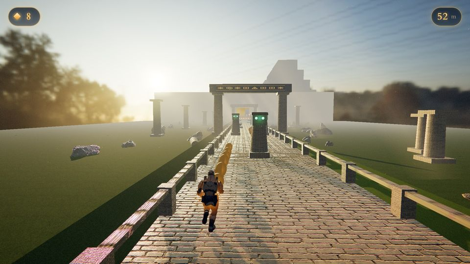

# Same prompt, two games: a temple runner without and with the Army plugin

[](https://omer-yehuda.github.io/sunken-road-runner/)

One prompt, run twice. `without/` is what came back from the prompt alone. `with/` is the same prompt taken through the [Army plugin](https://github.com/omer-yehuda/plugins/tree/main/plugins/army): a plan first, then a build, then two cold reviews and one fix loop.

The prompt is in [PROMPT.md](PROMPT.md).

| | `without/` | `with/` |
|---|---|---|
| Files | 1 | 8 (page, styles, 6 scripts), plus fonts |
| Lines | 215 | 729 |
| Look | flat colors, a box hero, one green field | photo sky that lights the scene, photo stone and grass, rigged human runner, gold relics, a bright zone and a dark zone |
| Plan before code | none | 9 testable checks ([opord.md](with/mission/opord.md)) |
| Review | none | 23 notes from a screenshot review, 21 fixed ([ux.md](with/mission/ux.md)) |
| Cold inspection | none | 8 of 9 checks passed, 1 failed and was fixed ([inspector-general.md](with/mission/inspector-general.md)) |
| Draw calls per frame | 123 | 709 to 747 |
| Triangles per frame | about 6,900 | about 50,000 to 55,000 |

The game rules are the same in both: three lanes, jump, slide, coins, three kinds of obstacle, rising speed. Only the look and the process differ.

## Play

Play both in your browser, no install: **https://omer-yehuda.github.io/sunken-road-runner/**

- Claude alone: https://omer-yehuda.github.io/sunken-road-runner/without/
- With the Army plugin: https://omer-yehuda.github.io/sunken-road-runner/with/ (loads its art from the web, give it a few seconds)

Arrow keys or WASD: change lane, jump, slide. On a phone: swipe.

To run it locally instead, serve the folder with any static server and open `without/` or `with/`:

```
npx serve .
```

## How the test was run (read this before quoting it)

- Both versions were written by Claude in one cloud session. The plain version was written first, before the Army plugin files were opened.
- The Army run followed the plugin's phases (briefing, operation order, build, ux review, inspection, after-action). The ux and inspector-general units ran as separate agents that had not seen the build; the engineering work was done by the main session, not by a dispatched unit.
- The briefing asked for the look. The answer was "realistic", so the first stylized build was replaced. The plain run has no briefing step, so it was never asked.
- The reviews in `with/mission/` were written against the first (stylized) build. The realistic rebuild kept those fixes but was not re-inspected.
- `with/` loads three.js, a sunrise sky photo, stone, grass and wood textures and the `Soldier` character from the three.js r170 examples through a CDN. Nothing from that repo is copied here; those files keep their own licenses. `without/` loads only three.js.
- Numbers come from `renderer.info` at 1280x720 in headless Chrome with software rendering. Frame time on a real GPU was not measured.
- `window.__game` in both pages is a test hook for the capture script (same hook in both).

## Honest limits

- The "with" version costs about six times more draw calls and about eight times more triangles.
- It needs a network connection for its art.
- It looks better; it does not play deeper. No new mechanics were added.
- Open items: restart keeps the world position, speed stops rising at 36 m/s, no hit animation.

Font: Cardo (SIL Open Font License, see `with/fonts/OFL.txt`).
